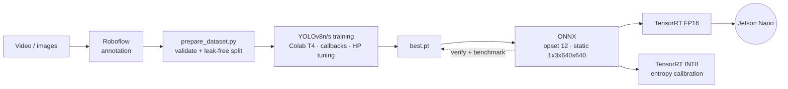
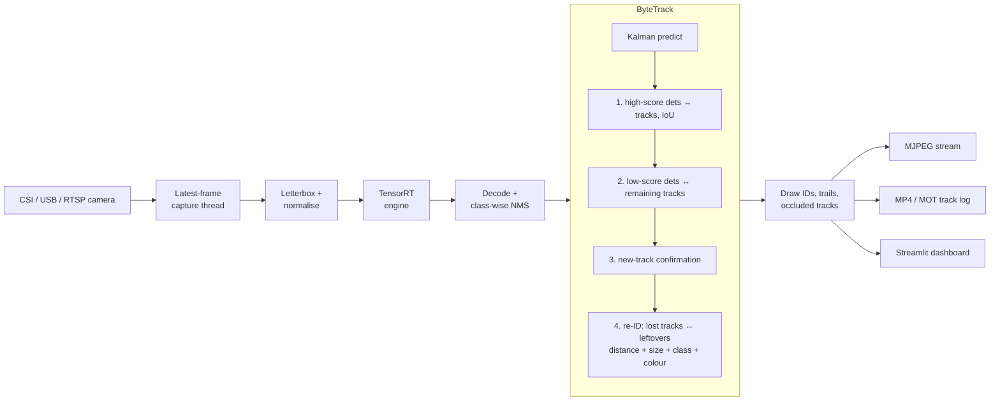

<div align="center">

# Real-Time Object Detection on Edge

**Detecting and tracking drones, vehicles and aircraft in real time on an NVIDIA Jetson Nano**
YOLOv8 · ONNX · TensorRT FP16/INT8 · ByteTrack · Streamlit

[%20%7C%203.9%2B-3776AB?logo=python&logoColor=white)](https://www.python.org/)
[](https://pytorch.org/)
[](https://docs.ultralytics.com/)
[](https://onnx.ai/)
[](https://developer.nvidia.com/tensorrt)
[](https://developer.nvidia.com/embedded/jetson-nano-developer-kit)
[](https://opencv.org/)
[](https://streamlit.io/)
[](https://plotly.com/python/)
[](https://roboflow.com/)
[](LICENSE)


</div>

---

## Contents
[Overview](#overview) · [Features](#key-features) · [Architecture](#architecture) · [Installation](#installation) ·
[Usage](#usage) · [Dataset](#dataset) · [Benchmarks](#benchmarks) · [Results](#results) ·
[Future work](#future-improvements) · [Acknowledgements](#acknowledgements)

## Overview

Small drones are hard to spot. They are often only a few pixels wide, they hover, and they move erratically. A
surveillance system needs to **detect** them, keep a **persistent identity** for each one across frames, and do it
**on the camera side**: sending video to a cloud GPU adds latency, costs bandwidth and raises privacy concerns, and it
fails when the network does.

This project builds a complete edge pipeline for that problem:

1. A **YOLOv8n/s** detector fine-tuned on a custom-annotated dataset of **drones, vehicles and aircraft**.
2. Optimised with **ONNX → TensorRT (FP16 / INT8)** for a 4 GB **Jetson Nano** (128-core Maxwell GPU, ~10 W).
3. **ByteTrack** multi-object tracking with an added **re-identification stage** for hovering and fast-moving drones.
4. Deployed as a headless **boot service** with a browser stream, plus a **Streamlit dashboard** for analysis and demos.

The research question: *how much speed does each optimisation step buy, what does it cost in accuracy, and can a
$99-class board track small aerial objects in real time?* The [benchmark tables](#benchmarks) answer it with
measured numbers.

## Key features

| | |
|---|---|
| **One runtime for 3 backends** | the same pre-processing, decoding and NMS code for PyTorch, ONNX Runtime and TensorRT, so comparisons isolate the inference engine |
| **Runs on stock JetPack 4.6** | the deploy path needs only numpy, scipy, OpenCV, TensorRT and pycuda and is **Python 3.6 compatible**: no PyTorch or Ultralytics on the Nano |
| **Export verification** | every ONNX/TensorRT export is checked against PyTorch, both on the raw output tensor and on the final detections |
| **ByteTrack + re-ID extension** | a 4th association stage re-links lost tracks by motion + colour. It keeps IDs where IoU matching fails: hovering drones and objects moving more than their own width per frame |
| **Leak-free dataset split** | Roboflow exports re-split by source video, so near-identical frames never end up in both train and test |
| **Reproducible benchmarks** | per-stage latency, p95, FPS, mAP, power (FPS/W) for each backend and device, as CSV, plots and README tables |
| **Edge deployment** | low-latency camera thread, hardware video decode, MJPEG browser stream, systemd service with clean shutdown |
| **Dashboard** | live tracking, latency gauge, per-class counts, backend comparison side by side, annotated-video download |

## Architecture

**Offline: from data to an edge engine**


**Online: per-frame pipeline on the device**


<details>
<summary><b>Repository layout</b></summary>

```
yolo-edge-tracker/
├── data/        prepare_dataset.py · download_roboflow.py · dataset.yaml · ROBOFLOW.md (labelling guide)
├── train/       train.py · tune.py · callbacks.py · plot_curves.py · evaluate.py · hyp_*.yaml · colab_train.ipynb
├── export/      export_onnx.py · build_engine.py · calibrator.py · verify.py · run_all.sh
├── track/       byte_tracker.py · kalman_filter.py · matching.py · appearance.py
├── deploy/      detectors.py · pipeline.py · run.py · camera.py · stream.py · check_engine.py
│                jetson_setup.sh · sync_to_jetson.sh · service/ (systemd) · JETSON.md
├── benchmark/   benchmark.py · eval_accuracy.py · report.py · parse_tegrastats.py
├── docs/        GUIDE.md (phase-by-phase build guide) · update_readme.py · make_assets.py · assets/
├── tests/       tracker, re-ID, post-processing, verification, callbacks, charts, dataset prep
└── app.py       Streamlit dashboard
```
</details>

## Installation

**Development machine / Colab** (training, export, dashboard). Python 3.9-3.12:
```bash
git clone https://github.com/<your-username>/yolo-edge-tracker.git && cd yolo-edge-tracker
python -m venv .venv && source .venv/bin/activate         # or: conda create -n yolo-edge python=3.11
pip install -r requirements.txt                            # install the CUDA build of PyTorch first on a GPU machine
pytest                                                     # unit tests
```
For TensorRT on a desktop GPU or Colab, also run `pip install tensorrt pycuda onnxruntime-gpu`.

**Jetson Nano** (JetPack 4.6.x: Python 3.6, CUDA 10.2, TensorRT 8.2):
```bash
bash deploy/sync_to_jetson.sh <user>@<jetson-ip>           # on the laptop: code + .onnx (never .engine)
bash deploy/jetson_setup.sh --headless                     # on the Nano: MAXN, swap, numpy/scipy/pycuda, video group
```
See [deploy/JETSON.md](deploy/JETSON.md) for versions, power supply, cooling and troubleshooting.

## Usage

| Step | Command |
|---|---|
| Prepare data (Roboflow YOLOv8 export) | `python data/prepare_dataset.py --roboflow data/raw/roboflow --group-pattern "^(.*)_\d+$"` |
| Train (or use [the Colab notebook](train/colab_train.ipynb)) | `python train/train.py --model yolov8n.pt --name yolo_custom` |
| Tune hyperparameters | `python train/tune.py --iterations 30 --epochs 20` → `train.py --hyp train/hyp_tuned.yaml` |
| Export to ONNX + verify | `python -m export.export_onnx --weights weights/yolo_custom.pt --images data/dataset/images/test` |
| Build TensorRT engine *(on the target device)* | `python3 -m export.build_engine --onnx weights/yolo_custom.onnx --fp16` |
| Verify all exports | `python3 -m export.verify --reference weights/yolo_custom.pt --models weights/yolo_custom.onnx weights/yolo_custom_fp16.engine --images data/dataset/images/test` |
| Track a video | `python -m deploy.run --weights weights/yolo_custom.onnx --source demo.mp4 --reid --save out.mp4 --save-txt tracks.txt` |
| Live camera on the Jetson | `python3 -m deploy.run --weights weights/yolo_custom_fp16.engine --source csi --reid --stream-port 8080` |
| Benchmark backends | `python3 -m benchmark.benchmark --images data/dataset/images/test --track --plot --weights <models...>` |
| Start at boot | `bash deploy/service/install_service.sh` |
| Dashboard | `streamlit run app.py` |

Export, engine build, verification and benchmark in one go: `bash export/run_all.sh runs/detect/yolo_custom/weights/best.pt data/dataset/images/test`.
Each stage is explained in the [build guide](docs/GUIDE.md).

## Dataset

Custom dataset annotated in [Roboflow](https://roboflow.com/) following a written labelling protocol
([data/ROBOFLOW.md](data/ROBOFLOW.md)). Three classes:

| ID | Class | Includes | Excludes |
|---:|---|---|---|
| 0 | `aircraft` | airliners, light aircraft, jets, helicopters | |
| 1 | `drone` | multirotor and fixed-wing UAVs | birds, kites, balloons (kept as hard negatives) |
| 2 | `vehicle` | cars, vans, trucks, buses, motorbikes | bicycles |

<!-- DATASET:START -->
_Statistics are generated from `data/dataset_stats.json`. Run `python data/prepare_dataset.py ...` and then `python docs/update_readme.py`._
<!-- DATASET:END -->

**Augmentation** is applied online during training ([train/hyp_surveillance.yaml](train/hyp_surveillance.yaml)):
small rotations only (axis-aligned boxes get loose otherwise), no vertical flips for ground cameras, limited zoom-out so
tiny drones stay visible, strong brightness/saturation jitter for backlit sky scenes, and mosaic switched off for the last 15 epochs.

## Benchmarks

All backends use identical pre/post-processing and the same test images. *End-to-end* = preprocess + inference + decode/NMS + ByteTrack.
Accuracy is measured on the held-out **test** split.

<!-- BENCHMARK:START -->
_Results are generated from `benchmark/results/*.csv`. Run the commands below and then `python docs/update_readme.py`._

| Model | Backend | Precision | Inference (ms) | End-to-end (ms) | FPS | Speed-up | mAP@50 | mAP@50-95 |
|:---|---|---|---:|---:|---:|---:|---:|---:|
| yolo_custom.pt | PyTorch | FP32 | - | - | - | 1.00x | - | - |
| yolo_custom.onnx | ONNX Runtime | FP32 | - | - | - | - | - | - |
| yolo_custom_fp16.engine | TensorRT | FP16 | - | - | - | - | - | - |
| yolo_custom_int8.engine | TensorRT | INT8 | - | - | - | - | - | - |
<!-- BENCHMARK:END -->

<details>
<summary><b>Reproduce</b></summary>

```bash
# speed (run on each device; rows are appended per device)
python3 -m benchmark.benchmark --images data/dataset/images/test --track --plot \
    --weights weights/yolo_custom.pt weights/yolo_custom.onnx weights/yolo_custom_fp16.engine weights/yolo_custom_int8.engine
# accuracy of every variant
python -m benchmark.eval_accuracy --weights weights/yolo_custom.pt weights/yolo_custom.onnx weights/yolo_custom_fp16.engine
# power on the Jetson (FPS per watt)
sudo tegrastats --interval 500 --logfile power.log & python3 -m deploy.run ... ; python3 -m benchmark.parse_tegrastats power.log --fps <FPS>
# tables + plots
python -m benchmark.report && python docs/update_readme.py
```
</details>

**Notes on interpreting the numbers**
- **INT8 on the Nano:** the Nano's Maxwell GPU has no fast INT8 path, so **FP16 is the deployment precision there**. INT8 gains are measured on a GPU with INT8 tensor cores (T4).
- **CPU share:** on the Nano, the CPU-side steps (letterbox, NMS, tracking) are a significant share of each frame. The per-stage breakdown shows where the remaining time goes.

<p align="center">
  
  
</p>

## Results

**Detections on test images**
<p align="center"></p>

**Training**
<p align="center">
  
  
</p>

**Tracking**
- *Occlusion:* occluded objects keep being predicted by the Kalman filter (grey dashed boxes) and get their original ID back when they reappear within the track buffer.
- *Re-ID extension:* in controlled tests, a drone that stops behind an occluder keeps its ID (plain ByteTrack assigns a new one). A 12 px drone moving 20 px/frame is tracked in 30/30 frames with one ID (plain ByteTrack: 1 frame). A different-coloured or different-class object appearing in the same place correctly gets a new ID ([tests/test_reid.py](tests/test_reid.py)).
- *Output format:* tracks can be exported in MOTChallenge format (`--save-txt`) for MOTA/IDF1 evaluation with [TrackEval](https://github.com/JonathonLuiten/TrackEval).

**Known limitations**
- Very small drones (< 10 px) at long range: recall drops, and colour-based re-ID falls back to motion only.
- Birds remain the most common false positive for `drone`.
- An object that leaves the scene for longer than the track buffer returns with a new ID. Re-ID here is short-term, not long-term appearance matching.

## Future improvements

- **Small objects:** SAHI tiled inference, a P2 (stride-4) detection head, or training at 960-1280 px.
- **Better re-ID:** a lightweight appearance embedding network (e.g. OSNet-x0.25 in TensorRT) for long-term re-identification.
- **Newer models:** YOLOv10 / YOLO11 / NMS-free heads, moving NMS off the Nano's CPU.
- **GPU pre-processing:** letterbox and normalisation in CUDA or via DeepStream/VPI, to cut CPU time per frame.
- **Explicit INT8 quantisation:** QAT / Q-DQ ONNX (TensorRT Model Optimizer) for INT8 on Orin-class devices without the calibration accuracy drop.
- **Multi-camera input** with DeepStream, and an alerting layer (geo-fences, dwell time, MQTT events).
- **Thermal/IR camera support** for night-time drone detection.
- **Tracking evaluation:** MOTA/HOTA/IDF1 on ID-annotated clips, comparing ByteTrack against BoT-SORT and OC-SORT.

## Acknowledgements

- [Ultralytics YOLOv8](https://github.com/ultralytics/ultralytics): detector and training framework
- Y. Zhang et al., *ByteTrack: Multi-Object Tracking by Associating Every Detection Box*, ECCV 2022 ([paper](https://arxiv.org/abs/2110.06864), [code](https://github.com/ifzhang/ByteTrack))
- [NVIDIA TensorRT](https://developer.nvidia.com/tensorrt) and [JetPack](https://developer.nvidia.com/embedded/jetpack)
- [Roboflow](https://roboflow.com/): annotation and dataset versioning

## License

This project uses Ultralytics YOLOv8, which is licensed under **AGPL-3.0**, so this repository is released under the
same license. See [LICENSE](LICENSE).

## Author

**&lt;Your Name&gt;**, B.Tech CSE (AI/ML), final-year project · [GitHub](https://github.com/<your-username>) · [LinkedIn](https://www.linkedin.com/in/<your-profile>)
